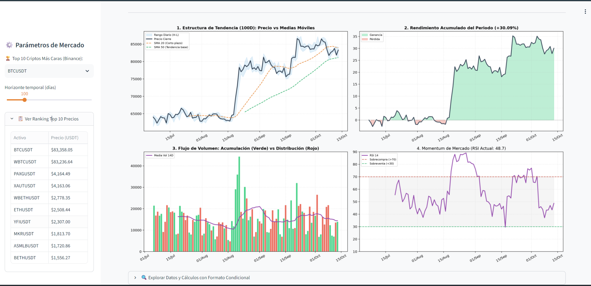
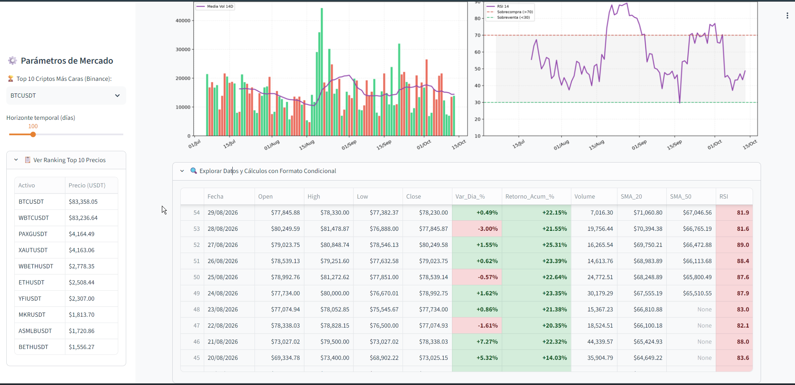
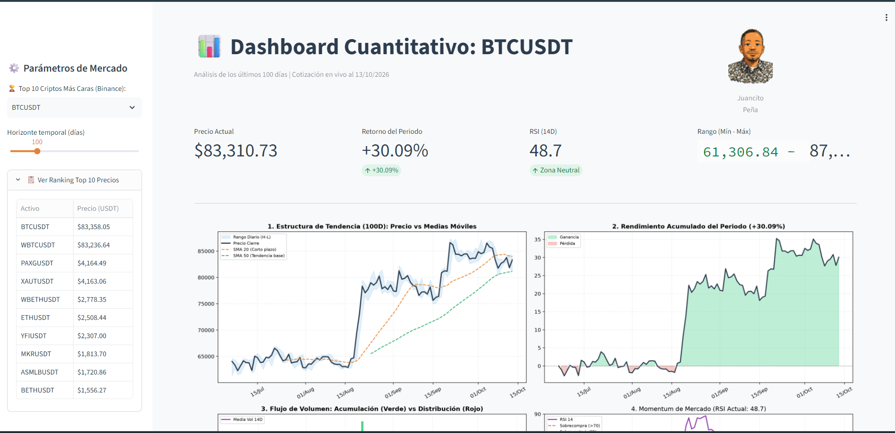

# 📈 Dashboard Cuantitativo de Criptomonedas & Bitcoin (Streamlit + Python)

[](https://streamlit.io/)
[](https://www.python.org/)
[](LICENSE)
[](https://binance-docs.github.io/apidocs/spot/en/)
[](https://share.streamlit.io/)

Aplicación analítica de trading cuantitativo e inteligencia de mercado desarrollada en **Python** con **Streamlit**, diseñada para monitorear, calcular y visualizar en tiempo real métricas financieras, medias móviles y momentum técnico sobre **Bitcoin (BTC)** y las criptomonedas de mayor cotización del mercado global mediante la API pública de **Binance**.

---

## 📸 Capturas de Pantalla

| Panel General y Métricas | Estructura Técnica y RSI |
| :---: | :---: |
|  |  |

| Tabla de Registros con Formato Condicional |
| :---: |
|  |

---

## 🛡️ Arquitectura Resiliente Multi-Endpoint (Solución Error HTTP 451)

### 📌 Diagnóstico del Error HTTP 451 en la Nube
Al desplegar aplicaciones en plataformas como **Streamlit Community Cloud**, los servidores y contenedores operan en centros de datos ubicados en Estados Unidos (ej. AWS `us-east-1`). Debido a regulaciones financieras estrictas de EE.UU. (SEC y CFTC), el endpoint internacional de Binance (`api.binance.com`) **bloquea por geolocalización** cualquier petición que provenga de datacenters estadounidenses, arrojando el error:

```text
451 Client Error: Unavailable For Legal Reasons for url: https://api.binance.com/api/v3/klines...
```

### ⚡ Estrategia de Conmutación por Error en Cascada (*Failover*)
Para asegurar **alta disponibilidad y cero tiempo de inactividad** tanto en ejecución local como en la nube, el sistema incorpora un gestor resiliente que consulta en milisegundos un pool jerarquizado de endpoints autorizados:

```text
                                  ┌──► [1] api.binance.com (Internacional / Residencial)
                                  │         │ (HTTP 451 / Bloqueo en EE.UU.)
                                  │         ▼
Petición de Mercado (Klines/Price) ┼──► [2] api.binance.us (Autorizado en Servidores USA / Streamlit Cloud)
                                  │         │ (Si ocurre timeout / 5xx)
                                  │         ▼
                                  ├──► [3] data-api.binance.vision (Endpoint Público Institucional)
                                  │         │
                                  │         ▼
                                  └──► [4] api1 / api2 / api3.binance.com (Espejos de contingencia)
```

1. **Fallback Automático e Invisible:** Si el endpoint internacional responde con `HTTP 451`, `403` o `Timeout`, la función conmuta de inmediato a `api.binance.us` (cuya estructura de respuesta JSON para Klines y Ticker es 100% compatible).
2. **Cabeceras HTTP Personalizadas:** Envío de `User-Agent` moderno para evitar falsos positivos de bloqueo por bots o scrapers.
3. **Caché en Memoria (`st.cache_data`):** Minimiza la carga de peticiones y optimiza la velocidad de respuesta (TTL de 10 min para ranking y 5 min para velas históricas).

---

## 🚀 Características Principales

1. **Top 10 Activos de Mayor Valor en Binance:**
   - Consulta dinámica con actualización en caché cada 10 minutos.
   - Filtro inteligente de pares en `USDT` descartando tokens derivados/apalancados (UP, DOWN, BULL, BEAR).
   - Selector interactivo en la barra lateral con ranking desplegable en vivo.

2. **Horizonte Temporal Ajustable:**
   - Slider interactivo para seleccionar marcos de análisis entre **30 y 365 días**.

3. **KPIs Cuantitativos en Tiempo Real:**
   - 💵 **Precio Actual (USDT)**.
   - 📊 **Retorno Acumulado del Periodo (%)** con delta porcentual dinámico.
   - ⚡ **RSI (14 Días)** con alertas automáticas de Sobrecompra (>70), Sobreventa (<30) y Zona Neutral.
   - 🎯 **Rango Mínimo y Máximo** del periodo evaluado.

4. **Matriz de Análisis Gráfico Multidimensional (4 Paneles con Matplotlib):**
   - **Panel 1 - Estructura de Tendencia:** Precio de cierre con bandas de rango diario (High - Low) y medias móviles simples (SMA 20 y SMA 50).
   - **Panel 2 - Rendimiento Acumulado:** Evolución porcentual de rentabilidad con áreas sombreadas dinámicas (Verde para ganancia, Rojo para pérdida).
   - **Panel 3 - Flujo de Volumen Direccional:** Barras coloreadas por velas (Acumulación vs Distribución) con media móvil de volumen de 14 periodos.
   - **Panel 4 - Momentum de Mercado (RSI 14):** Oscilador con zonas críticas de sobrecompra (>70) y sobreventa (<30).

5. **Explorador de Datos con Formato Condicional Avanzado:**
   - Tabla interactiva con `pd.Styler` aplicando semáforos de color a variaciones diarias, retornos acumulados y niveles de RSI.
   - Formato monetario estandarizado y fechas en formato `DD/MM/YYYY`.

---

## 🛠️ Tecnologías y Librerías

- **[Python](https://www.python.org/)** (v3.10+)
- **[Streamlit](https://streamlit.io/)** - Framework web interactivo de alto rendimiento.
- **[Requests](https://requests.readthedocs.io/)** - Consumo de endpoints REST públicos con arquitectura failover.
- **[Pandas](https://pandas.pydata.org/)** - Transformación de series temporales, cálculos cuantitativos y formateo condicional.
- **[NumPy](https://numpy.org/)** - Operaciones vectorizadas y cálculo numérico.
- **[Matplotlib](https://matplotlib.org/)** - Visualización y maquetación de gráficos financieros multieje.

---

## 📦 Estructura del Repositorio

```text
├── .streamlit/
│   └── config.toml          # Configuración de tema visual (colores y modo headless)
├── IMG/
│   ├── JUANCITOPENA.png     # Foto de perfil del autor
│   ├── Screenshot_1.png     # Captura de pantalla de la interfaz
│   ├── Screenshot_2.png     # Captura de pantalla de gráficos
│   └── Screenshot_74.png    # Captura de la tabla cuantitativa
├── .gitignore               # Exclusión de venv, temporales y caché
├── app.py                   # Código principal con resiliencia multi-endpoint
├── requirements.txt         # Dependencias del proyecto
├── LICENSE                  # Licencia MIT
└── README.md                # Documentación técnica exhaustiva
```

---

## 💻 Instalación y Ejecución Local

### 1. Clonar el repositorio
```bash
git clone https://github.com/JUANCITOPENA/Dashboard_Cuantitativo_Bitcoin_Python_mas_Streamlit.git
cd Dashboard_Cuantitativo_Bitcoin_Python_mas_Streamlit
```

### 2. Crear y activar entorno virtual
```bash
# En Windows (PowerShell)
python -m venv venv
.\venv\Scripts\Activate.ps1

# En Linux / macOS
python3 -m venv venv
source venv/bin/activate
```

### 3. Instalar dependencias
```bash
pip install -r requirements.txt
```

### 4. Iniciar la aplicación
```bash
streamlit run app.py
```

La aplicación se abrirá automáticamente en tu navegador en:
```text
http://localhost:8501
```

---

## ☁️ Despliegue en Streamlit Community Cloud

Para desplegar este dashboard de forma gratuita en la nube con compatibilidad total:

1. Haz un fork o sube este repositorio a tu cuenta de GitHub.
2. Ingresa a [share.streamlit.io](https://share.streamlit.io/) e inicia sesión con tu cuenta de GitHub.
3. Haz clic en **"New app"**.
4. Selecciona:
   - **Repository:** `JUANCITOPENA/Dashboard_Cuantitativo_Bitcoin_Python_mas_Streamlit`
   - **Branch:** `main`
   - **Main file path:** `app.py`
5. Haz clic en **"Deploy"**.

*(Gracias a la arquitectura resiliente incorporada en `app.py`, la aplicación superará automáticamente las restricciones de geolocalización de Binance en servidores de EE.UU.)*

---

## 👨‍💻 Autor

**Ing. Juancito Peña V.**  
*Arquitecto de Soluciones de Datos, Analítica y Desarrollo Cuantitativo*  
- GitHub: [@JUANCITOPENA](https://github.com/JUANCITOPENA)

---

## 📄 Licencia

Este proyecto se distribuye bajo la Licencia **MIT**. Consulta el archivo [LICENSE](LICENSE) para más detalles.
